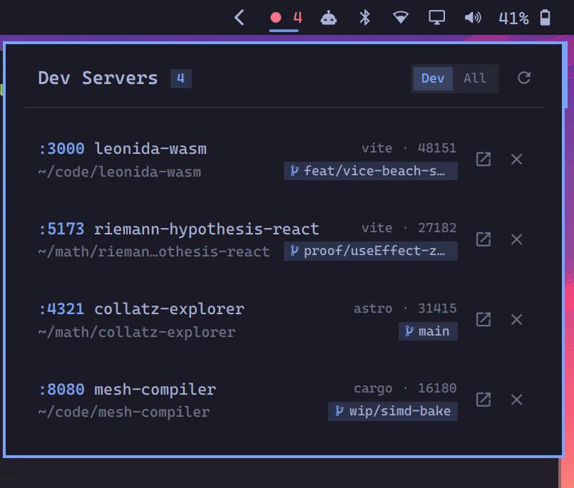
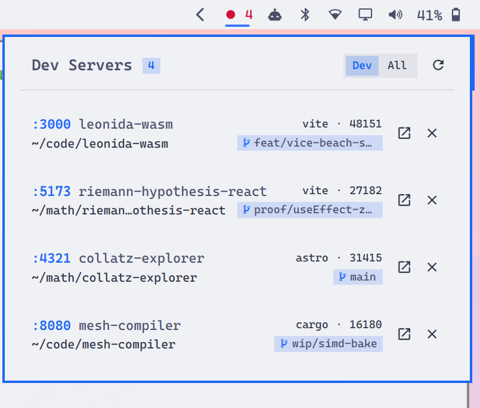
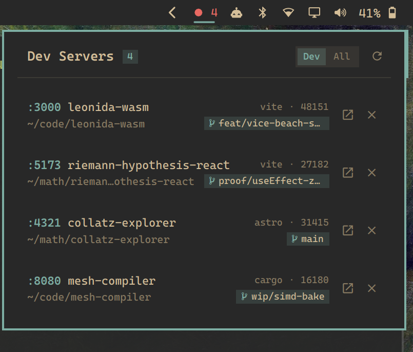
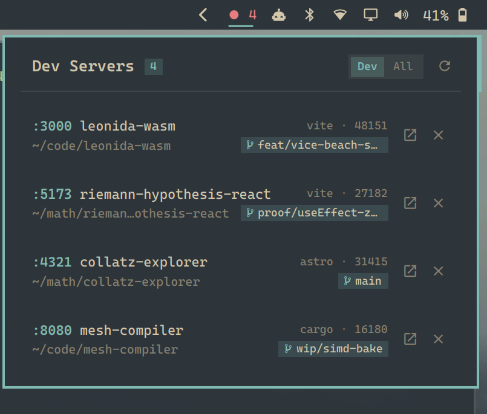

# omaport

A native **Omarchy bar widget** and **zero-dependency Rust CLI** for seeing and managing locally running dev servers.

At a glance in your bar, a filled circle + count tells you how many local dev servers are active (or a clean outline circle when none are running). Click it to inspect every server's port, working directory, Git branch, framework, and PID — then **Open** it in your default browser or **Kill** it in one click or keystroke.

<p align="center">
  
</p>

### Follows your Omarchy theme live

| Tokyo Night | Catppuccin Latte |
| :---: | :---: |
|  |  |

| Gruvbox | Everforest |
| :---: | :---: |
|  |  |

---

## Features

- **Minimal bar indicator**: Crisp filled circle + active server count when dev servers are running; outline circle when idle. Follows your active Omarchy theme, accent color, font, and Hyprland corner rounding live.
- **Zero-dependency Rust scanner (`omaport`)**: Reads `/proc/net/tcp`, `/proc/net/tcp6`, and `/proc/<pid>/*` directly in ~1–3 ms — no `sudo`, no `ss`, no `lsof`, and no `git` subprocess fan-out.
- **Working directory & Git branch**: Resolves `.git/HEAD` directly by walking upward from each process's `cwd`, including **git worktrees** (`gitdir:` pointer files) and detached HEAD short SHAs.
- **Smart dev-server filtering (`Dev` | `All`)**: Recognizes common frameworks and runtimes (`vite`, `next`, `nuxt`, `astro`, `sveltekit`, `remix`, `bun`, `deno`, `node`, `python`, `uvicorn`, `django`, `flask`, `rails`, `cargo`, `go`, `php`, `hugo`, `caddy`, etc.) while filtering out desktop/IDE/agent noise — with a one-click **`Dev` | `All`** toggle in the header to inspect every user-owned listening TCP port.
- **Scales to many servers**: Bounded-height scrollable `ListView` with scrollbar and an automatic live search filter (port, directory, branch, framework, or PID) when 6+ servers are running.
- **One-click Open & safe Kill**:
  - **Open**: Launches `http://localhost:<port>` via `omarchy-launch-browser` and focuses your browser window in Hyprland.
  - **Kill**: Verifies current-user ownership and confirms the PID is still listening on the expected port before sending `SIGTERM` (with `SIGKILL` fallback), guarding against PID-reuse races.
- **Dual-stack & worker-pool aware**: Deduplicates IPv4 + IPv6 listeners on the same PID/port and targets the parent-most PID when a server forks workers.

---

## Requirements

- [Omarchy](https://omarchy.org/) (with `omarchy-shell`)
- Rust toolchain (`cargo` / `rustc`) for building from source

---

## Installation

### Community install (prebuilt binary + `omarchy plugin add`)

1. Install the `omaport` binary from [GitHub Releases](https://github.com/pipetogrep/omaport/releases) into `~/.local/bin/omaport` (or `/usr/bin/omaport` via `pkgbuild/PKGBUILD`):

```bash
# Example for x86_64 Linux (replace v0.1.0 with the latest release tag)
curl -fL https://github.com/pipetogrep/omaport/releases/latest/download/omaport-v0.1.0-linux-x86_64.tar.gz \
  | tar -xz --strip-components=1 -C ~/.local/bin omaport-v0.1.0-linux-x86_64/omaport
chmod +x ~/.local/bin/omaport
```

2. Add and enable the Omarchy bar plugin directly from GitHub:

```bash
omarchy plugin add https://github.com/pipetogrep/omaport.git --enable
```

Update later anytime with `omarchy plugin update pipetogrep.omaport`.

### Build from source (local development)

```bash
./bin/install
```

The install script compiles the release Rust binary, installs the plugin to `~/.config/omarchy/plugins/pipetogrep.omaport/`, installs the CLI to `~/.local/bin/omaport`, validates the manifest via `omarchy plugin validate`, and enables `pipetogrep.omaport` in the right section of your bar (persisted in `~/.config/omarchy/shell.json`).

### Startup Behavior

Because `pipetogrep.omaport` is registered in `~/.config/omarchy/shell.json` under `bar.layout`, **`omarchy-shell` loads it automatically on every login and reboot** — no separate systemd service or Hyprland `exec-once` rule is required.

To move the widget to another bar section:

```bash
omarchy bar move pipetogrep.omaport --section centerEnd
```

---

## How to Use

### From the Bar

- **Status indicator**: Look for the circle in your Omarchy bar:
  - **Filled circle + count**: one or more local dev servers are running.
  - **Outline circle**: no local dev servers are currently running.
- **Left-click** the indicator to open or close the popup.
- **Middle-click** the indicator to force an immediate refresh.
- Inside the popup:
  - **Click a server row** (or its **Open** button) to open `http://localhost:<port>` in your default browser and focus it in Hyprland.
  - **Click the `×` button** on a row to safely terminate that server (`SIGTERM`, with `SIGKILL` fallback if needed).
  - **Toggle `Dev` | `All`** in the header to switch between detected **Dev Servers** and **All Ports** (every user-owned listening TCP socket).
  - **Scroll** when many servers are running; once 6+ servers are active, a **search bar** appears automatically so you can filter by port, directory, branch, framework, or PID.

### Optional Hyprland Keybinding

You can toggle the popup from anywhere using `omarchy-shell pipetogrep.omaport toggle` (for example in `~/.config/hypr/bindings.lua`):

```lua
o.bind("SUPER CTRL, P", "Omaport", "exec", "omarchy-shell pipetogrep.omaport toggle")
```

---

## Configuration

Configure `pipetogrep.omaport` via `omarchy bar set` or directly in `~/.config/omarchy/shell.json`:

| Key | Type | Default | Description |
|---|---|---|---|
| `refreshIntervalSec` | integer (`3–300`) | `10` | Background polling interval in seconds while the popup is closed (polls every 4s while open). |
| `showCount` | boolean | `true` | Show the active server count next to the circle in the bar. |
| `showAllPorts` | boolean | `false` | Default to showing all user-owned listening TCP ports instead of dev servers only. |

Example:

```bash
omarchy bar set pipetogrep.omaport showCount false
omarchy bar set pipetogrep.omaport refreshIntervalSec 5
```

---

## Keyboard Shortcuts

Inside the Omaport popup:

| Key | Action |
|---|---|
| `↑` / `↓` or `j` / `k` | Move selection |
| `Enter` or `o` | Open selected server in default browser |
| `x` | Kill selected server |
| `r` | Refresh server list |
| `a` | Toggle between **Dev Servers** and **All Ports** |
| `/` | Focus search filter (when visible) |
| `Esc` | Clear search filter or close panel |

You can also toggle the popup over IPC (for Hyprland keybindings):

```bash
omarchy-shell pipetogrep.omaport toggle
```

---

## CLI Usage

The `omaport` binary is installed to `~/.local/bin/omaport` and works standalone in any terminal or script:

```bash
omaport list                                  # List local dev servers
omaport list --all                            # Include all user-owned listening TCP ports
omaport list --json                           # Machine-readable JSON output
omaport kill <pid> [--port <port>] [--force]  # Safely terminate a server
```

Example `omaport list --json` output:

```json
{
  "servers": [
    {
      "pid": 2024612,
      "port": 5173,
      "host": "::1",
      "url": "http://localhost:5173",
      "name": "vite",
      "command": "node ./node_modules/.bin/vite --port 5173",
      "cwd": "/home/user/Developer/app",
      "cwdShort": "~/Developer/app",
      "project": "app",
      "branch": "main",
      "isDev": true
    }
  ]
}
```

---

## Architecture

```text
├── manifest.json             # Omarchy plugin manifest (schemaVersion: 1, pipetogrep.omaport)
├── Panel.qml                 # Bar status dot + KeyboardPanel popup + keybinds
├── Service.qml               # Polling timer, Process runner, Open & Kill hooks
├── ServerRow.qml             # Server card (port, project, dir, branch, PID, actions)
├── PlainText.qml             # Text.PlainText wrapper (prevents markup injection)
├── i18n/en.json              # Translations catalog (Commons.Translations)
├── Cargo.toml                # Zero-dependency Rust crate (`omaport`)
├── src/
│   ├── main.rs               # CLI entry point & JSON serializer
│   ├── proc_scan.rs          # Direct /proc/net/tcp{,6} + /proc/<pid>/* scanner
│   ├── git.rs                # .git/HEAD & git-worktree branch resolver
│   ├── filter.rs             # Dev-server classification & framework detection
│   └── kill.rs               # Ownership + port-verified SIGTERM/SIGKILL
├── pkgbuild/PKGBUILD         # Arch Linux package definition
├── .github/workflows/
│   ├── ci.yml                # Rust tests, release build, and manifest validation
│   └── release.yml           # Tagged Linux x86_64 & aarch64 release tarballs + SHA256SUMS
└── bin/
    └── install               # Local build, install plugin + CLI, validate & enable in bar
```

---

## Development & Testing

```bash
# Run Rust unit tests (TCP hex parsing, git/worktree resolution, filtering, JSON escaping)
cargo test

# Rebuild, reinstall, and validate the Omarchy plugin
./bin/install

# Restart omarchy-shell if QML files changed
omarchy restart shell
```

## License

MIT
